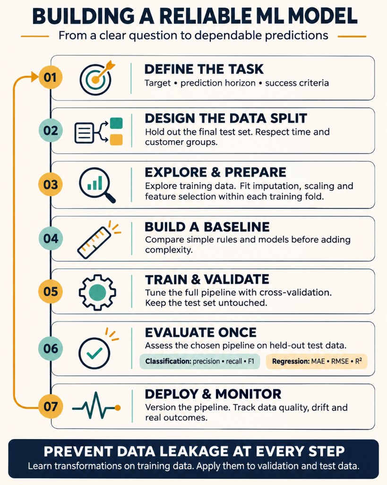

# Building a Reliable ML Model

A machine learning model is only as reliable as the process used to build and evaluate it.

This diagram outlines a familiar workflow: explore the data, prepare it, split it, train algorithms, tune hyperparameters, and evaluate predictions. Each step looks straightforward. Each also contains decisions that can undermine the entire result.

Let's walk through what those decisions involve.

## Define exactly what the model should predict

The example includes age, income, sex, a score, and a target labelled “LOAN.” But what does that target represent? A loan application? An approval? Successful repayment?

These are different problems.

A model trained on historical approvals learns patterns in previous lending decisions. Predicting default requires repayment outcomes and a defined prediction horizon.

Before selecting an algorithm, we need a precise target, a clear intended use, and an understanding of which information will be available when the prediction is made.

## Explore how the data was generated

Exploratory Data Analysis (EDA) includes distributions, missing values, summary statistics, and relationships between variables. Those calculations help us identify questions worth investigating.

Why is income missing for some customers? Did the collection process change? Does an extreme value represent an error or a legitimate rare case? Are multiple records associated with the same person?

The answers determine how we prepare the data and how confidently we can generalise from it.

Removing an unusual observation without understanding it may remove exactly the situation the model needs to recognise.

## Keep learned preprocessing inside the training process

The diagram places data processing before the train–test split. That ordering needs qualification.

Operations that learn from the dataset—such as imputing missing values using a mean, scaling features, fitting PCA, or selecting features based on their relationship with the target—must be fitted using training data only.

The fitted transformations are then applied to validation and test data.

Otherwise, information from the evaluation data influences model development. This is data leakage, and it can produce results that look substantially better than performance on genuinely unseen cases. The same boundary must hold within every cross-validation fold.

## Choose a split that represents future use

A 70/30 split is an example, not a universal requirement.

For time-dependent predictions, training should precede the evaluation period. If several records belong to the same customer, keeping that customer’s records together may be necessary to evaluate performance on unseen customers.

A random split can place closely related observations on both sides of the boundary, making the task easier than it will be in production.

The evaluation design should reflect the situations in which we expect the model to operate.

## Establish a baseline before adding complexity

The diagram lists several algorithm families: Support Vector Machines, nearest neighbours, decision trees, Random Forest, and Gradient Boosting.

Before comparing them, establish what a simple approach can achieve. That might be a constant prediction, an existing business rule, or a straightforward statistical model.

A baseline gives improvement a meaning.

A more complex model should deliver enough value to justify its additional training cost, inference requirements, maintenance effort, and explanation burden.

## Treat tuning, feature selection, and validation as one connected procedure

Hyperparameters control aspects of the learning process, such as tree depth or regularisation strength. Search methods explore candidate configurations, while validation estimates how well those configurations generalise.

Feature selection also belongs inside this process. Selecting features using the entire dataset and then cross-validating the model compromises the independence of the validation.

The diagram’s “Cross-Validation Model” label can also be misleading: cross-validation is an evaluation procedure, rather than a separate model type.

The final test set should remain outside algorithm selection and tuning. Repeatedly changing the model in response to test results gradually turns that test set into another development set.

## Select metrics according to the consequences of errors

Imagine a dataset with 1,000 cases, only 10 of which are positive.

A model that predicts “negative” for every case achieves 99% accuracy. It also misses every positive case.

That is why classification evaluation needs to examine which errors occur: how many relevant cases we detect, how many alerts are correct, and what false positives and false negatives cost.

For regression, the choice also matters. MAE expresses average absolute error in the target’s units. RMSE gives greater weight to large errors. R² provides another perspective, but does not tell us whether the prediction error is acceptable for the intended use.

A metric becomes useful when we can connect it to a decision and its consequences.

## Extend the workflow beyond the trained model

Deployment introduces changing inputs, changing behaviour, and changing operating conditions.

A usable system needs data-quality checks, versioned models and transformations, monitoring of outcomes when they become available, and clear ownership when performance deteriorates.

It also needs a defined response: investigate, retrain, roll back, or route uncertain cases for review.

The diagram ends with evaluation. The responsibility continues for as long as people rely on the predictions.

Building a reliable ML model means being able to explain what it predicts, what information it uses, how its quality was measured, and under which conditions its results can be trusted.

## Related notes

- [Overfitting in Business](overfitting-in-business.md) — signal vs noise when models memorize the training set
- [ML Algorithms](ml-algorithms.md) — the algorithm landscape beyond a single workflow diagram
- [SHAP](shap.md) — explaining individual predictions after the model is built
- [Monitoring & Post-Market Surveillance](../ai-act/monitoring-and-post-market-surveillance.md) — responsibility does not end at deployment
